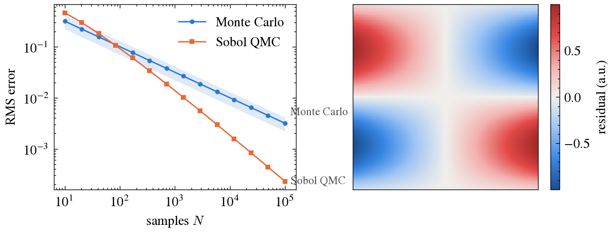

# llplot

A matplotlib house style for journal figures. It sits on [SciencePlots](https://github.com/garrettj403/SciencePlots)
(`science` + `no-latex`, vendored) and adds:

- a colour-blind-safe palette, with a marker shape for every series;
- the colormaps `llplot_seq` (one hue) and `llplot_div` (centred on 0);
- figure sizes at one or two journal columns, so figures go into a paper unscaled;
- `savefig` with a size budget, which keeps figures in git small.



## Install

```bash
pip install "llplot @ git+https://github.com/ll-research/llplot@v0.1.0"
```

In another package's `pyproject.toml`, pin a tag so results can be reproduced:

```toml
dependencies = ["llplot @ git+https://github.com/ll-research/llplot@v0.1.0"]
```

To work on llplot itself: `git clone https://github.com/ll-research/llplot && pip install -e llplot`.

## Use

```python
import llplot

llplot.setup()                       # once; setup(grid=True) adds a light grid, setup(latex=True) uses LaTeX
fig, ax = llplot.figure("single")    # 3.5 in wide; "double" is 7.2 in
llplot.lines(ax, x, {"Monte Carlo": y1, "Sobol QMC": y2}, err={"Monte Carlo": e1})
ax.set(xlabel="samples $N$", ylabel="RMS error")
llplot.savefig(fig, "fig/convergence.png")   # lowers PNG dpi until the file is under 300 kB
```

`llplot.image(ax, data, label="...", diverging=True)` draws a 2-D field with a colorbar.
`llplot.CATEGORICAL`, `SEQUENTIAL` and `DIVERGING` hold the colours for custom plots.

## Versions

Tags follow `vMAJOR.MINOR.PATCH`. A change that alters how existing figures look raises MINOR (or MAJOR before
removals), so a pinned tag always renders the same figures.
